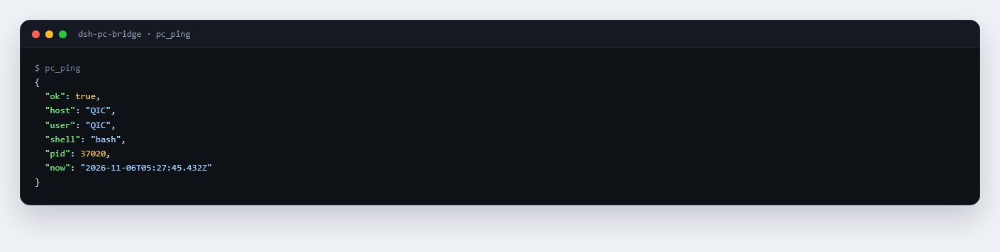

# dsh-pc-bridge

[](https://www.npmjs.com/package/dsh-pc-bridge)
[](https://github.com/QIC-9821/dsh-pc-bridge/actions/workflows/ci.yml)
[](LICENSE)
[](package.json)

A DeepSeek Harness plugin that runs an HTTP bridge on a machine so a peer (a cloud QQ bot, a build runner, another agent) can ping it and run shell commands. It listens on loopback by default; **Settings → 电脑执行桥** switches it to the LAN, discovers nearby bridges over UDP, exchanges the secret with a 6-digit pairing code, remembers the paired peer across restarts, and owns a master switch that stops the listener without unloading the plugin. An **ssh reverse tunnel** is still available for reaching it from elsewhere.

It ships a `pcctl` CLI too, so the bridge is usable from a terminal without Harness.

## Demo

Ask whether the machine is up and you get host, user, shell and the server clock:



Want something from it, run a command there — below the cloud bot lists a directory and reads the last commits on the home machine:


Both are real output, not mock-ups. The bridge runs commands through Git Bash, where Node is not on `PATH`, so keep to what that shell can do.

## Pieces

- **Host bridge** (`role: host | both`): a `node:http` server with `POST /exec` and `GET|POST /ping`, every request carrying `x-pc-secret`; `GET /health` and `POST /pair` are unauthenticated (the latter needs a pairing code).
- **Runtime and settings** (`lib/runtime.mjs`, `lib/settings.mjs`): start/stop, status, tool registration and the audit log; the settings file `$DSH_HOME/pc-bridge/settings.json` wins over the plugin config and survives restarts.
- **Discovery and pairing** (`lib/discovery.mjs`, `lib/pairing.mjs`): UDP 18791 answers `DSHBRIDGE/1` scans; 6-digit single-use codes, 300 s TTL, 5 failures per IP lock the code for 10 minutes.
- **Tools**: `pc_ping` and `pc_exec`, pointing at `http://127.0.0.1:18790` by default; with `toolsMode: auto` they are only registered when a `peerUrl` (or `remoteMode`) is configured.
- **Tunnel supervisor** (`tunnelEnabled: true`): keeps `ssh -N -R ...` alive, reconnects with 5/10/30/60 s backoff, and clears a stale remote listener with `fuser -k` when sshd still holds the port.
- **CLI**: `pcctl ping`, `pcctl exec -- "hostname"`.

## Install

Pick one:

```bash
# npm (recommended)
dsh plugin add dsh-pc-bridge

# straight from the GitHub tag
dsh plugin add github:QIC-9821/dsh-pc-bridge#v0.3.1

# local checkout (development)
dsh plugin add /absolute/path/to/dsh-pc-bridge
```

You can also install this directory as a Harness bundle from the plugin manager. Node.js ≥ 22; no third-party runtime dependencies.

```yaml
- id: dsh-pc-bridge
  name: 'dsh-pc-bridge'
  config:
    role: both
    listenHost: 127.0.0.1
    listenPort: 18790
    tunnelEnabled: true
    sshHost: 203.0.113.10
    sshUser: dsh
    sshKeyPath: C:/Users/me/.ssh/id_ed25519
```

## Config

| Key | Default | Meaning |
| --- | --- | --- |
| `role` | `both` | `host` = bridge only; `client` = tools/tunnel only; `both` = everything |
| `listenHost` | `127.0.0.1` | bind address — **do not use 0.0.0.0** |
| `listenPort` | `18790` | bind port |
| `secretFile` | `$DSH_HOME/pc-bridge/secret` | shared secret; any path (`~`, absolute, or relative to the state dir); a host generates one (32-byte hex, mode 600) when missing |
| `enabled` | `true` | master switch; off = no listener, no tools, no discovery; the settings page keeps working |
| `secretEnv` | `DSH_PC_BRIDGE_SECRET` | environment variable checked before the file |
| `peerUrl` | `http://127.0.0.1:18790` | which bridge the tools call |
| `defaultTimeoutMs` | `30000` | default command timeout |
| `maxTimeoutMs` | `600000` | largest timeout a request may ask for |
| `maxOutputBytes` | `2097152` | per-stream cap; extra output sets `truncated` |
| `shellPath` | auto | shell executable; Windows prefers Git Bash, then PowerShell; POSIX uses `/bin/bash` |
| `cwd` | current directory | command working directory |
| `tunnelEnabled` | `false` | keep an ssh reverse tunnel open |
| `sshHost` / `sshUser` | empty | tunnel target |
| `sshKeyPath` | empty | private key; empty = ssh default |
| `tunnelRemotePort` / `tunnelLocalPort` | `18790` | forwarded ports (both bound to 127.0.0.1) |
| `toolsMode` | `auto` | `auto` registers tools only with a `peerUrl` / non-`off` `remoteMode`; `always` / `off` force it |
| `remoteMode` | `off` | `off` / `tailscale` / `ssh` (Tailscale serve lands in 0.4.0) |
| `discoveryEnabled` | `true` | answer UDP discovery probes |
| `discoveryPort` | `18791` | discovery port |
| `pairTtlSec` | `300` | pairing-code lifetime (30–3600 s) |
| `auditKeep` | `5` | rotated `audit.jsonl` generations kept |
| `purgeOnUninstall` | `false` | experimental: on teardown, delete the data dir when the profile no longer depends on this plugin |

## Peer setup

1. Add this machine's public key to the peer user's `~/.ssh/authorized_keys`.
2. Put the same secret in the peer's environment, e.g. systemd `Environment=DSH_PC_BRIDGE_SECRET=...`.
3. On the peer, verify once the tunnel is up:

```bash
curl -s http://127.0.0.1:18790/ping -H "x-pc-secret: $DSH_PC_BRIDGE_SECRET"
PC_BRIDGE_SECRET=... pcctl exec -- "hostname; echo OK"
```

## Security

- Loopback only; the tunnel binds both ends to `127.0.0.1`, so no public port is opened.
- Every request is checked against the shared secret (`timingSafeEqual`); missing or wrong → 401.
- Body ≤ 64 KiB, command ≤ 8 KiB, output truncated, timeout kills the process tree.
- The secret never sits in config, and logs record only where it came from (`env:` / `file:`).
- This is arbitrary command execution. Give the secret only to a peer you trust, and only enable the tunnel for that peer.

## Tools

- `pc_ping` → `{ok, host, user, shell, now}` or a network error.
- `pc_exec {"command":"...","timeoutSec":30}` → `{ok, exitCode, stdout, stderr, durationMs, timedOut, truncated}`.

## Development

```bash
npm test                     # node --test test/*.test.mjs
node --check index.js
```

Tests cover shell selection/fallback, tunnel args and backoff, server auth/routes/timeout clamp/truncation, client network errors, secret generation and priority, and real command execution with a timeout.

## Settings UI, LAN and pairing (0.3.1)

Open **Settings → 电脑执行桥**. Everything the page changes is written to
`$DSH_HOME/pc-bridge/settings.json` and applied on the next start:

- master switch (`enabled`): applies immediately (no save button); off stops the
  listener, discovery and tool registration while the plugin and this page stay
  loaded;
- status (state, address, uptime, registered tools, secret source/fingerprint,
  Tailscale address, paired peer, tunnel, discovery, last error);
- connection mode: loopback / LAN (`0.0.0.0`) / custom `peerUrl`; switching mode
  keeps a paired address;
- nearby computers: one UDP scan, then fill `peerUrl` with one click;
- pairing: show a 6-digit code, or enter a peer address plus its code. The peer's
  name, platform, transport and pairing time are remembered, plus a history of up
  to 10 paired devices (deduped by address) with a "disconnect" action;
- secret path: changing `secretFile` migrates the file — write the new one
  (mode 600), verify it, persist the setting, restart, then delete the old file
  (a failed delete only warns); refused when the secret comes from the plugin
  config or an environment variable. The bridge restarts in-process (milliseconds);
  DSH itself is not restarted;
- "delete local data": removes the secret, `settings.json`, `audit.jsonl*` and
  `bridge.log*` after a confirmation;
- tools: one checkbox — "register pc_ping / pc_exec even without a paired peer".
  Unchecked (default) registers only with a `peerUrl` / non-`off` `remoteMode`
  (saves ~0.3k tokens per turn); checked means `toolsMode: always`. Use the
  master switch to turn tools off entirely;
- the footer has only "save and apply", "test connection" and "rotate secret";
  saving restarts the bridge listener only, never DSH;
- advanced limits, discovery toggle and the last 20 `audit.jsonl` entries.

Uninstalling the plugin removes its code through the package manager, but
`$DSH_HOME/pc-bridge/` is data and is not removed with the package. DSH has no
public uninstall hook: use "delete local data" before removing the plugin, or
opt into `purgeOnUninstall` (experimental — it checks on teardown whether the
profile still depends on this plugin).

Cross-network options remain: the ssh reverse tunnel from this plugin, Tailscale
(the status card already shows the tailnet address), or an external tunnel such
as Cloudflare Tunnel. LAN mode opens a port, so use a strong secret and restrict
the firewall to trusted networks.

## License

MIT
