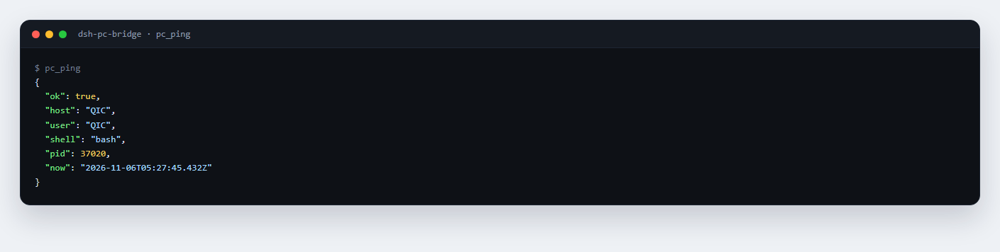
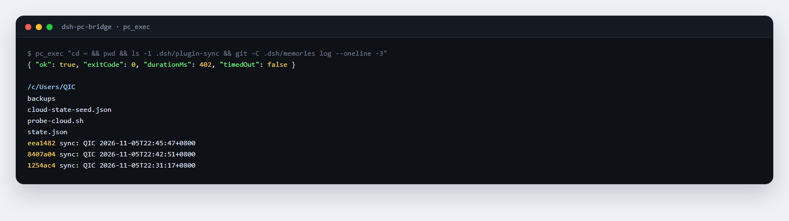

# dsh-pc-bridge

[](https://www.npmjs.com/package/dsh-pc-bridge)
[](https://github.com/QIC-9821/dsh-pc-bridge/actions/workflows/ci.yml)
[](LICENSE)
[](package.json)

A DeepSeek Harness plugin that runs a **loopback-only** HTTP bridge on a machine so a peer (a cloud QQ bot, a build runner, another agent) can ping it and run shell commands; optionally it also keeps an **ssh reverse tunnel** open so the remote side can reach that loopback port.

It ships a `pcctl` CLI too, so the bridge is usable from a terminal without Harness.

## Demo

Ask whether the machine is up and you get host, user, shell and the server clock:



Want something from it, run a command there — below the cloud bot lists a directory and reads the last commits on the home machine:



Both are real output, not mock-ups. The bridge runs commands through Git Bash, where Node is not on `PATH`, so keep to what that shell can do.

## Pieces

- **Host bridge** (`role: host | both`): a `node:http` server with `POST /exec` and `GET|POST /ping`, every request carrying `x-pc-secret`.
- **Tools**: `pc_ping` and `pc_exec`, pointing at `http://127.0.0.1:18790` by default.
- **Tunnel supervisor** (`tunnelEnabled: true`): keeps `ssh -N -R ...` alive, reconnects with 5/10/30/60 s backoff, and clears a stale remote listener with `fuser -k` when sshd still holds the port.
- **CLI**: `pcctl ping`, `pcctl exec -- "hostname"`.

## Install

Pick one:

```bash
# npm (recommended)
dsh plugin add dsh-pc-bridge

# straight from the GitHub tag
dsh plugin add github:QIC-9821/dsh-pc-bridge#v0.1.0

# local checkout (development)
dsh plugin add /absolute/path/to/dsh-pc-bridge
```

You can also install this directory as a Harness bundle from the plugin manager. Node.js ≥ 22; no third-party runtime dependencies.

```yaml
- id: dsh-pc-bridge
  name: 'dsh-pc-bridge'
  config:
    role: both
    listenHost: 127.0.0.1
    listenPort: 18790
    tunnelEnabled: true
    sshHost: 203.0.113.10
    sshUser: dsh
    sshKeyPath: C:/Users/me/.ssh/id_ed25519
```

## Config

| Key | Default | Meaning |
| --- | --- | --- |
| `role` | `both` | `host` = bridge only; `client` = tools/tunnel only; `both` = everything |
| `listenHost` | `127.0.0.1` | bind address — **do not use 0.0.0.0** |
| `listenPort` | `18790` | bind port |
| `secretFile` | `$DSH_HOME/pc-bridge/secret` | shared secret; a host generates one (32-byte hex, mode 600) when missing |
| `secretEnv` | `DSH_PC_BRIDGE_SECRET` | environment variable checked before the file |
| `peerUrl` | `http://127.0.0.1:18790` | which bridge the tools call |
| `defaultTimeoutMs` | `30000` | default command timeout |
| `maxTimeoutMs` | `600000` | largest timeout a request may ask for |
| `maxOutputBytes` | `2097152` | per-stream cap; extra output sets `truncated` |
| `shellPath` | auto | shell executable; Windows prefers Git Bash, then PowerShell; POSIX uses `/bin/bash` |
| `cwd` | current directory | command working directory |
| `tunnelEnabled` | `false` | keep an ssh reverse tunnel open |
| `sshHost` / `sshUser` | empty | tunnel target |
| `sshKeyPath` | empty | private key; empty = ssh default |
| `tunnelRemotePort` / `tunnelLocalPort` | `18790` | forwarded ports (both bound to 127.0.0.1) |

## Peer setup

1. Add this machine's public key to the peer user's `~/.ssh/authorized_keys`.
2. Put the same secret in the peer's environment, e.g. systemd `Environment=DSH_PC_BRIDGE_SECRET=...`.
3. On the peer, verify once the tunnel is up:

```bash
curl -s http://127.0.0.1:18790/ping -H "x-pc-secret: $DSH_PC_BRIDGE_SECRET"
PC_BRIDGE_SECRET=... pcctl exec -- "hostname; echo OK"
```

## Security

- Loopback only; the tunnel binds both ends to `127.0.0.1`, so no public port is opened.
- Every request is checked against the shared secret (`timingSafeEqual`); missing or wrong → 401.
- Body ≤ 64 KiB, command ≤ 8 KiB, output truncated, timeout kills the process tree.
- The secret never sits in config, and logs record only where it came from (`env:` / `file:`).
- This is arbitrary command execution. Give the secret only to a peer you trust, and only enable the tunnel for that peer.

## Tools

- `pc_ping` → `{ok, host, user, shell, now}` or a network error.
- `pc_exec {"command":"...","timeoutSec":30}` → `{ok, exitCode, stdout, stderr, durationMs, timedOut, truncated}`.

## Development

```bash
npm test                     # node --test test/*.test.mjs
node --check index.js
```

Tests cover shell selection/fallback, tunnel args and backoff, server auth/routes/timeout clamp/truncation, client network errors, secret generation and priority, and real command execution with a timeout.

## License

MIT
