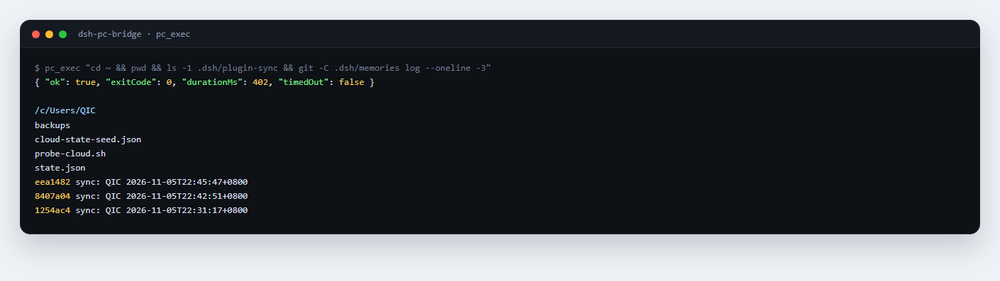

# dsh-pc-bridge

[](https://www.npmjs.com/package/dsh-pc-bridge)
[](https://github.com/QIC-9821/dsh-pc-bridge/actions/workflows/ci.yml)
[](LICENSE)
[](package.json)

A DeepSeek Harness plugin that runs a small HTTP bridge on a machine so a peer (another computer, a tablet or a cloud bot) can `ping` it and run shell commands on demand. It listens on loopback by default; since 0.3.0 **Settings → 电脑执行桥** can switch it to the LAN, discover nearby bridges over UDP and exchange the secret with a 6-digit pairing code; since 0.4.0 it can also be reached directly over Tailscale (**Remote (Tailscale)** mode) and automatically puts WARP into DNS-only mode so the two coexist. An **ssh reverse tunnel** remains available as well.

It ships a `pcctl` CLI too, so the bridge is usable from a terminal without Harness.

## Demo

Ask whether the machine is up and you get host, user, shell and the server clock:


Want something from it, run a command there — below the cloud bot lists a directory and reads the last commits on the home machine:



Both are real output, not mock-ups. The bridge runs commands through Git Bash, where Node is not on `PATH`, so keep to what that shell can do.

## Pieces

- **Host bridge** (`role: host | both`): a `node:http` server with `POST /exec` and `GET|POST /ping`, every request carrying `x-pc-secret`; `GET /health` and `POST /pair` are unauthenticated (the latter needs a 6-digit pairing code).
- **Runtime and settings** (`lib/runtime.mjs`, `lib/settings.mjs`): start/stop, status, tool registration and the audit log; the settings file `$DSH_HOME/pc-bridge/settings.json` wins over the plugin config and survives restarts.
- **LAN discovery** (`lib/discovery.mjs`): UDP 18791 broadcasts `DSHBRIDGE/1`; a scan dedupes replies and returns `host:port` together with the peer identity.
- **Pairing** (`lib/pairing.mjs`): 6-digit single-use codes, 300 s TTL by default; 5 consecutive failures from one IP lock pairing for 10 minutes.
- **Tools**: `pc_ping` (liveness) and `pc_exec` (run a command). With `toolsMode: auto` they stay registered only when a peer is configured or `remoteMode` is not `off`, so an idle bridge does not spend tokens on tool schemas every turn.
- **Remote network** (`lib/tailscale.mjs`, `lib/warp.mjs`, 0.4.0): reads `tailscale status --json` for the tailnet address and the remote URL shown in Settings; with `warpCoexist` on, a WARP tunnel is switched to "DNS only" (`warp-cli mode doh`) at start so Tailscale's control connection comes back.
- **Tunnel supervisor** (`tunnelEnabled: true`): keeps `ssh -N -R ...` alive, reconnects with 5/10/30/60 s backoff, and clears a stale remote listener with `fuser -k` when sshd still holds the port.
- **CLI**: `pcctl ping`, `pcctl exec -- "hostname"`.

## Install

Pick one:

```bash
# npm (recommended)
dsh plugin add dsh-pc-bridge

# straight from the GitHub tag
dsh plugin add github:QIC-9821/dsh-pc-bridge#v0.4.1

# local checkout (development)
dsh plugin add /absolute/path/to/dsh-pc-bridge
```

You can also install this directory as a Harness bundle from the plugin manager. Node.js ≥ 22; no third-party runtime dependencies.

After installing, open **Settings → 电脑执行桥** and configure the keys below.

```yaml
- id: dsh-pc-bridge
  name: 'dsh-pc-bridge'
  config:
    role: both
    listenHost: 127.0.0.1
    listenPort: 18790
    tunnelEnabled: true
    sshHost: 203.0.113.10
    sshUser: dsh
    sshKeyPath: C:/Users/me/.ssh/id_ed25519
```

## Config

| Key | Default | Meaning |
| --- | --- | --- |
| `role` | `both` | `host` = bridge only; `client` = tools/tunnel only; `both` = everything |
| `listenHost` | `127.0.0.1` | bind address; LAN mode uses `0.0.0.0`, which **requires** a strong secret and a firewall that allows only trusted networks |
| `listenPort` | `18790` | bind port |
| `secretFile` | `$DSH_HOME/pc-bridge/secret` | shared secret; any path (`~`, absolute, or relative to the state dir); a host generates one (32-byte hex, mode 600) when missing |
| `enabled` | `true` | master switch; off = no listener, no tools, no discovery; the settings page keeps working |
| `secretEnv` | `DSH_PC_BRIDGE_SECRET` | environment variable checked before the file |
| `peerUrl` | `http://127.0.0.1:18790` | which bridge the tools call |
| `defaultTimeoutMs` | `30000` | default command timeout |
| `maxTimeoutMs` | `600000` | largest timeout a request may ask for (10 minutes) |
| `maxOutputBytes` | `2097152` | per-stream cap; extra output sets `truncated` |
| `shellPath` | auto | shell executable; Windows prefers Git Bash, then PowerShell; POSIX uses `/bin/bash` |
| `cwd` | current directory | command working directory |
| `tunnelEnabled` | `false` | keep an ssh reverse tunnel open |
| `sshHost` / `sshUser` | empty | tunnel target |
| `sshKeyPath` | empty | private key; empty = ssh default |
| `tunnelRemotePort` / `tunnelLocalPort` | `18790` | forwarded ports (both bound to 127.0.0.1) |
| `toolsMode` | `auto` | `auto` registers tools only with a `peerUrl` / non-`off` `remoteMode`; `always` keeps them registered; `off` disables them |
| `fileEnabled` | `true` | serve the file channel (`/file/stat|list|read|write`). Off means these endpoints are not mounted at all (404), whatever the tools say |
| `fileToolsEnabled` | `false` | separate switch for `pc_file_list` / `pc_file_read` / `pc_file_write`. Off keeps them unregistered (saves tokens every turn); independent of `toolsMode`, so `toolsMode: off` + this on still registers the three file tools |
| `fileRoots` | `[]` | directories the peer may read and write (empty = no restriction); relative entries resolve against `cwd` |
| `fileChunkBytes` | `1048576` | transfer chunk size (64 KiB–16 MiB) |
| `fileMaxBytes` | `67108864` | per-file transfer cap (1 MiB–4 GiB) |
| `remoteMode` | `off` | `off` / `tailscale` / `ssh`. `tailscale` binds the tailnet address when Tailscale is online (falling back to `0.0.0.0` when it is not) and shows the remote URL on the settings page; any non-`off` value keeps `pc_ping` / `pc_exec` registered |
| `warpCoexist` | `true` | with `remoteMode: tailscale`, if WARP is in tunnel mode at start, switch it to DNS-only (`warp-cli mode doh`) so Tailscale stays online; `false` leaves WARP completely alone |
| `discoveryEnabled` | `true` | answer UDP discovery probes |
| `discoveryPort` | `18791` | discovery port |
| `pairTtlSec` | `300` | pairing-code lifetime (30–3600 s) |
| `auditKeep` | `5` | rotated `audit.jsonl` generations kept |
| `purgeOnUninstall` | `false` | experimental: on teardown, delete the data dir when the profile no longer depends on this plugin |

## Settings UI (0.5.0)

Open **Settings → 电脑执行桥**. Everything the page changes is written to
`$DSH_HOME/pc-bridge/settings.json` (on Windows: `C:\Users\<you>\.dsh\pc-bridge\settings.json`) and applies on the next start:

- master switch card (`enabled`): takes effect immediately, no save needed; off keeps the plugin and this page loaded but stops the listener, `pc_ping` / `pc_exec` registration and UDP discovery;
- status card: state, listen address, uptime, registered tools, secret source and fingerprint, Tailscale address, peer connection, tunnel, discovery, last error;
- **Remote (Tailscale) & WARP** card: whether Tailscale is online, the tailnet address, a copyable remote URL; three buttons — "WARP DNS-only (coexist)", "restore WARP tunnel", "refresh network state" — and a "put WARP into DNS-only mode at start in remote mode" checkbox (`warpCoexist`);
- connection mode, four choices: this machine (`127.0.0.1`) / LAN (`0.0.0.0`) / Remote (Tailscale — binds the tailnet address, falling back to `0.0.0.0` when Tailscale is offline) / custom `peerUrl`; switching mode does not clear a paired address;
- nearby computers: one UDP scan, then fill `peerUrl` with a click;
- pairing: show a 6-digit code, or enter a peer address plus its code. The peer's name, platform, transport and pairing time are remembered, plus a history of up to 10 paired devices (deduped by address) with a "disconnect" action;
- tools: one checkbox — "register pc_ping / pc_exec even without a paired peer". Unchecked (default) registers only with a `peerUrl` / non-`off` `remoteMode` (saves ~0.3k tokens per turn); checked means `toolsMode: always`. Use the master switch to turn tools off entirely;
- **file transfer** (the second tab at the top of this section; a sub-page of 电脑执行桥, not a separate settings section):
  - "file tools" checkbox (`fileToolsEnabled`, **off** by default): while off the three `pc_file_*` tools are not registered at all — that is the default, so their schemas cost nothing per turn; turning it on and saving takes effect immediately;
  - "let the peer access files on this machine" checkbox (`fileEnabled`, on by default), plus `fileRoots` (one root per line), `fileChunkBytes` and `fileMaxBytes`; changing these restarts the listener once;
  - a "self-test" button at the bottom (`POST /pc-bridge/api/file-test`): writes, reads, stats and deletes a temp file locally and returns per-step timings, to prove the file layer and the root configuration really work;
- the footer has only "save and apply", "test connection" and "rotate secret"; saving restarts the bridge listener only (milliseconds, in-process), **never DSH**; a patch touching only `toolsMode` / `fileToolsEnabled` does not restart at all — it just re-registers the tool table;
- advanced: port, timeouts, output cap, pairing-code lifetime, audit generations, discovery toggle, secret file path (`secretFile`), uninstall cleanup;
- secret path: changing `secretFile` migrates the file — write the new one (mode 600), verify it, persist the setting, restart, then delete the old file (a failed delete only warns, no rollback); refused while the secret comes from the plugin config or an environment variable;
- "delete local data": a button behind a confirmation; removes the secret, `settings.json`, `audit.jsonl*` and `bridge.log*` (the directory stays);
- audit: the last 20 `audit.jsonl` entries (start / stop / restart / config / pair / exec / secret).

The page talks to the local API `/pc-bridge/api/*`, which is separate from the
`/ping` and `/exec` channels the agent uses.

> Uninstall: the plugin's own code is removed by the package manager, but
> `$DSH_HOME/pc-bridge/` is data and is not removed with the package. With
> `purgeOnUninstall` the teardown tries to clean it once the profile no longer
> depends on this plugin, but DSH has no public uninstall hook, so treat that as
> experimental. The reliable path is to click "delete local data" before
> uninstalling.

## Ways to connect

| Scenario | How | Notes |
| --- | --- | --- |
| Same machine / self-test | the default `127.0.0.1:18790` | simplest; the tools call this machine |
| Same Wi-Fi / hotspot | Settings → LAN, so `listenHost` becomes `0.0.0.0`; the peer uses `pc_exec`'s `peer` argument or fills in `peerUrl` | the firewall must allow 18790/TCP; use a strong secret |
| Different network (Tailscale) | install Tailscale on both ends and sign into the same tailnet; choose **Remote (Tailscale)** and save — the page gives you `http://<tailnet-IP>:18790` | allow 18790 through the firewall (see below); with WARP installed keep `warpCoexist` on |
| Public internet / no Tailscale | keep the plugin's ssh reverse tunnel (`tunnelEnabled`), or put something like Cloudflare Tunnel in front | the bridge never listens on the public internet by itself |

Pairing flow (both ends on 0.4.0):

1. The host clicks "generate pairing code" and gets a 6-digit number (300 s, single use);
2. The peer enters the host address and the code under "pair with a peer" and confirms;
3. Both ends switch to the same secret and reconnect; the tools and `pcctl` work from then on.

### Remote (Tailscale) setup

1. Install Tailscale on both ends and sign into the same tailnet (`tailscale status` shows both online);
2. On the host, switch "connection mode" to **Remote (Tailscale)** and click "save and apply"; the bridge binds the tailnet address (or falls back to `0.0.0.0` while Tailscale is offline), and the status / remote card shows that address;
3. Allow the port on the host firewall, for the tailnet only (administrator PowerShell):

```powershell
New-NetFirewallRule -DisplayName "dsh-pc-bridge (Tailscale)" -Direction Inbound `
  -Action Allow -Protocol TCP -LocalPort 18790 -RemoteAddress 100.64.0.0/10
```

4. From the peer (tablet / phone / another computer), open `http://<tailnet-IP>:18790/health`; `{"ok":true,...}` means it works. Then pair the two, or fill in `peerUrl` directly.

**WARP note**: WARP's tunnel swallows Tailscale's control connection (controlplane/DERP), so the machine stays offline in the tailnet. Consumer WARP excludes `100.64.0.0/10` by default, but only for the peer addresses — the control connection still breaks. In 0.4.0 `warpCoexist` (on by default) switches WARP to "DNS only" (`warp-cli mode doh`) when the **Remote (Tailscale)** mode starts: DNS protection stays, the tunnel goes, and Tailscale comes back. The settings page can also run "WARP DNS-only (coexist)" or "restore WARP tunnel" at any time.

## Peer setup (a cloud server, for example)

1. Add this machine's public key to the peer user's `~/.ssh/authorized_keys`.
2. Put the same secret in the peer's environment, e.g. systemd:

```ini
[Service]
Environment=DSH_PC_BRIDGE_SECRET=replace-with-the-same-string
```

3. On the peer, verify once the tunnel is up:

```bash
curl -s http://127.0.0.1:18790/ping -H "x-pc-secret: $DSH_PC_BRIDGE_SECRET"
```

4. The peer can use `pcctl` directly:

```bash
PC_BRIDGE_SECRET=... pcctl ping
PC_BRIDGE_SECRET=... pcctl exec -- "hostname; echo OK"
PC_BRIDGE_SECRET=... pcctl file list /tmp
PC_BRIDGE_SECRET=... pcctl file get /tmp/report.pdf --out ./report.pdf
PC_BRIDGE_SECRET=... pcctl file put ./build.zip /srv/app/build.zip
```

## Security

- Loopback by default; the ssh tunnel also binds both ends to `127.0.0.1`. Only LAN mode (`0.0.0.0`) or Remote (Tailscale) deliberately opens a port.
- Every `/ping`, `/exec` and `/info` request is checked against the shared secret (`timingSafeEqual`); missing or wrong → 401.
- `/pair` is unauthenticated but requires a 6-digit single-use code; 5 consecutive failures from one IP lock pairing for 10 minutes, and a code expires after 300 s by default.
- `/health` returns only version, platform and capabilities — no hostname, user or secret.
- `/file/stat|list|read|write` sit at the same level as `/exec`: same shared secret, 401 without it; with `fileEnabled: false` the routes are not mounted at all (404).
- Paths are confined to `fileRoots` (resolved through `realpath` first, so a symlink/junction pointing outside a root is refused with 403); an empty `fileRoots` means "no restriction" — tighten it when you need to.
- Body ≤ 64 KiB, command ≤ 8 KiB; output is truncated; a timeout kills the process tree; uploads go to `<target>.pcbridge-<uploadId>.part` and are renamed only after the last chunk's whole-file sha256 matches, so a failed transfer never leaves half a target file.
- The secret never sits in config, and logs record only where it came from (`env:` / `file:`); the audit log stores commands and exit codes, never output.
- The bridge is **arbitrary command execution**. Give the secret or pairing code only to peers you trust, and only open LAN mode or a tunnel for such a peer.

## Tools

- `pc_ping` → `{ok, host, user, shell, now}` or a network error.
- `pc_exec {"command":"...","timeoutSec":30}` → `{ok, exitCode, stdout, stderr, durationMs, timedOut, truncated}`.
- `pc_file_list {"path":"/data"}` → directory entries (`name/type/size/mtime`), optional `limit`.
- `pc_file_read {"path":"...","offset":0,"maxBytes":65536,"encoding":"auto"}` → one inline chunk (UTF-8 text or base64, plus `sha256` and `nextOffset`); pass `dest` instead to download the whole file (writes `.pcbridge.part`, verifies every chunk's sha256, then renames).
- `pc_file_write {"path":"...","content":"..."}` → inline write (≤ 1 MiB); pass `source` to upload a local file (chunked, per-chunk sha256, whole-file sha256 on the last chunk); `append` and `createDirs` are optional.
- The three `pc_file_*` tools are registered only while "file transfer → file tools" is on in the settings page, so `toolsMode` (`pc_ping`/`pc_exec`) and `fileToolsEnabled` can be switched independently.
- The default `toolsMode: auto` does not keep either tool registered while no `peerUrl` is configured (each tool schema costs about 0.3k tokens per turn); switch to `always` on the settings page, or fill in `peerUrl`.

## Audit

`$DSH_HOME/pc-bridge/audit.jsonl` holds one JSON object per line: start/stop, config changes, pairing, executions (command, exit code, duration, source IP — no output), WARP mode switches, and file operations (`kind:"file"`: `op`, `path`, `bytes`, `ok`, `ms`, `ip` — **never file contents**).
The file rotates at 1 MB and keeps `auditKeep` generations; the settings page shows only the last 20 entries.

## Development

```bash
npm test                     # node --test test/*.test.mjs
node --check index.js
```

Tests cover shell selection/fallback, tunnel args and backoff, server auth/routes/timeout clamp/truncation, client network errors, secret generation and priority, and real command execution with a timeout.

## License

MIT
