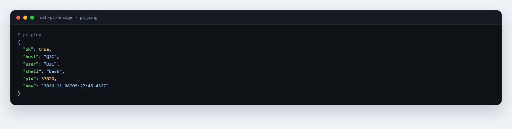
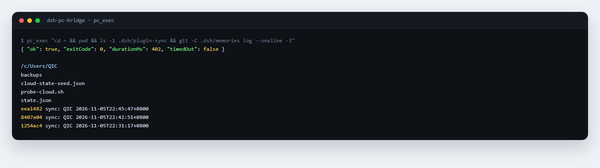

# dsh-pc-bridge

[](https://www.npmjs.com/package/dsh-pc-bridge)
[](https://github.com/QIC-9821/dsh-pc-bridge/actions/workflows/ci.yml)
[](LICENSE)
[](package.json)

DeepSeek Harness 插件：在电脑上开一个小 HTTP 桥，让对端（另一台电脑、平板或云端机器人）能 `ping` 这台电脑、并按需执行 shell 命令。默认只监听回环；从 0.3.0 起可以在**设置 → 电脑执行桥**里切到局域网、用 UDP 发现附近的设备、用 6 位配对码交换密钥；0.4.0 起可以直接选「远程（Tailscale）」异地直连，并自动把 WARP 切成「仅 DNS」以免和 Tailscale 打架。也可以继续用 ssh 反向隧道。

仓库里同时提供一个命令行 `pcctl`，不依赖 Harness 也可以在终端里直接调桥。

## 演示

对端问一句「这台机器在不在」，回的是主机名、用户、shell 类型和服务器时间：



要拿东西就在这台机器上跑命令——下面是远端（云端 QQ 机器人）让我在家里的电脑上列目录、读 git 提交记录：



两条都是真跑出来的输出，不是示意。注意桥走的是 Git Bash，PATH 里没有 Node，能用的命令以本机 Git Bash 为准。

## 组成

- **Host 桥**（`role: host | both`）：`node:http` 服务，`POST /exec`、`GET|POST /ping`，每个请求都要带 `x-pc-secret` 头；`GET /health` 与 `POST /pair` 免鉴权（后者要 6 位配对码）。
- **运行时与设置**（`lib/runtime.mjs`、`lib/settings.mjs`）：启停、状态、工具注册、审计日志；设置写入 `$DSH_HOME/pc-bridge/settings.json`，优先级高于插件 config，重启后仍然生效。
- **局域网发现**（`lib/discovery.mjs`）：UDP 18791 广播 `DSHBRIDGE/1`，扫描时去重并按对端身份返回 `host:port`。
- **配对**（`lib/pairing.mjs`）：6 位数字、默认 300 秒有效、单次使用；同一 IP 连续失败 5 次锁 10 分钟。
- **工具**：Agent 可调用 `pc_ping`（探活）与 `pc_exec`（执行命令）；`toolsMode: auto` 时只有配置了对端或开着 `remoteMode` 才常驻注册，避免每轮对话白占 token。
- **远程网络**（`lib/tailscale.mjs`、`lib/warp.mjs`，0.4.0）：读 `tailscale status --json` 拿到 tailnet 地址并在设置页显示远程 URL；开启 `warpCoexist` 时若 WARP 正在跑隧道，就自动切到「仅 DNS」（`warp-cli mode doh`），让 Tailscale 的控制连接恢复。
- **隧道管理器**（`tunnelEnabled: true`）：守着 `ssh -N -R ...`，断了按 5/10/30/60 秒退避重连；远端 sshd 残留占用端口时先 `fuser -k` 再重试。
- **CLI**：`pcctl ping`、`pcctl exec -- "hostname"`。

## 安装

三种方式选一：

```bash
# npm（推荐）
dsh plugin add dsh-pc-bridge

# 直接从 GitHub tag 装
dsh plugin add github:QIC-9821/dsh-pc-bridge#v0.5.0

# 本地目录（开发时）
dsh plugin add /absolute/path/to/dsh-pc-bridge
```

也可以在插件管理器里把本目录当 bundle 安装。要求 Node.js ≥ 22；没有任何第三方运行时依赖。

安装后在 Harness 设置里找到「电脑执行桥」，按下面的键配置。

```yaml
- id: dsh-pc-bridge
  name: 'dsh-pc-bridge'
  config:
    role: both
    listenHost: 127.0.0.1
    listenPort: 18790
    tunnelEnabled: true
    sshHost: 203.0.113.10
    sshUser: dsh
    sshKeyPath: C:/Users/me/.ssh/id_ed25519
```

## 配置

| 键 | 默认 | 说明 |
| --- | --- | --- |
| `role` | `both` | `host` 只开桥；`client` 只注册工具/隧道；`both` 全开 |
| `listenHost` | `127.0.0.1` | 监听地址；局域网模式用 `0.0.0.0`，此时**必须**配强密钥并确认防火墙只放行可信网段 |
| `listenPort` | `18790` | 监听端口 |
| `secretFile` | `$DSH_HOME/pc-bridge/secret` | 密钥文件；可自定义（支持 `~`、绝对路径、相对 stateDir）；不存在时 host 角色自动生成（32 字节 hex，权限 600） |
| `enabled` | `true` | 总开关；关掉后不监听、不注册工具、不跑发现，设置页仍可用 |
| `secretEnv` | `DSH_PC_BRIDGE_SECRET` | 优先级高于密钥文件的环境变量名 |
| `peerUrl` | `http://127.0.0.1:18790` | 工具调用哪个桥 |
| `defaultTimeoutMs` | `30000` | 默认命令超时 |
| `maxTimeoutMs` | `600000` | 请求可指定的最大超时（10 分钟） |
| `maxOutputBytes` | `2097152` | stdout/stderr 各自截断上限，超出部分标记 `truncated` |
| `shellPath` | 自动 | 指定 shell 可执行文件；默认 Windows 优先 Git Bash（`C:\Program Files\Git\bin\bash.exe`），没有才用 PowerShell；POSIX 用 `/bin/bash` |
| `cwd` | 当前目录 | 命令工作目录 |
| `tunnelEnabled` | `false` | 是否维持 ssh 反向隧道 |
| `sshHost` / `sshUser` | 空 | 隧道目标 |
| `sshKeyPath` | 空 | 私钥路径；空 = 默认密钥 |
| `tunnelRemotePort` / `tunnelLocalPort` | `18790` | 远端/本端端口（都绑 127.0.0.1） |
| `toolsMode` | `auto` | `auto` 只有配了 `peerUrl` 或 `remoteMode` 才注册工具；`always` 常驻；`off` 不注册 |
| `fileEnabled` | `true` | 是否开放文件通道（`/file/stat|list|read|write`）。关掉后这四个端点直接 404，工具再开也用不了 |
| `fileToolsEnabled` | `false` | 文件工具（`pc_file_list` / `pc_file_read` / `pc_file_write`）的独立开关。关着就不注册，每轮省 token；与 `toolsMode` 分开控制，打开时即使 `toolsMode: off` 也注册 |
| `fileRoots` | `[]` | 允许读写的根目录列表（空 = 不限制，但只对 `fileEnabled` 生效）；按 `cwd` 解析相对路径 |
| `fileChunkBytes` | `1048576` | 传输分块大小（64 KiB–16 MiB） |
| `fileMaxBytes` | `67108864` | 单个文件传输上限（1 MiB–4 GiB） |
| `remoteMode` | `off` | `off` / `tailscale` / `ssh`。选 `tailscale` 时优先绑 tailnet 地址（Tailscale 不在线才退回 `0.0.0.0`），设置页显示 tailnet 远程地址；非 `off` 时工具常驻 |
| `warpCoexist` | `true` | `remoteMode: tailscale` 时，启动时若发现 WARP 在隧道模式就自动切到「仅 DNS」（`warp-cli mode doh`），让 Tailscale 保持在线；设 `false` 则完全不动 WARP |
| `discoveryEnabled` | `true` | 是否回应局域网 UDP 发现 |
| `discoveryPort` | `18791` | 发现端口 |
| `pairTtlSec` | `300` | 配对码有效期（30–3600 秒） |
| `auditKeep` | `5` | `audit.jsonl` 超过 1 MB 时保留的历史份数 |
| `purgeOnUninstall` | `false` | 实验性：插件被移除时尝试删除本机数据（密钥/设置/审计/日志）。依赖 DSH 在卸载时触发插件 teardown，默认关 |

## 设置页（0.5.0）

安装后打开 **设置 → 电脑执行桥**，里面能改的东西都会写进 `$DSH_HOME/pc-bridge/settings.json`
（Windows 默认 `C:\Users\<你>\.dsh\pc-bridge\settings.json`），下次启动仍然生效：

- 开关卡：总开关（`enabled`），拨动即生效、不用点保存。关掉后插件照常加载、设置页照常可用，但不监听端口、不注册 `pc_ping` / `pc_exec`、不跑 UDP 发现；
- 状态卡：运行状态、监听地址、运行时长、已注册的工具、密钥来源与指纹、Tailscale 地址、对端连接、隧道、发现、最近错误；
- 远程连接（Tailscale）与 WARP：显示 Tailscale 是否在线、tailnet 地址、可复制的远程 URL；提供「WARP 只做 DNS（共存）」「恢复 WARP 隧道」「刷新网络状态」三个按钮，以及「远程模式启动时自动让 WARP 只做 DNS」勾选框（`warpCoexist`）；
- 连接方式：本机（`127.0.0.1`）/ 局域网（`0.0.0.0`）/ 远程（Tailscale，优先绑 tailnet 地址，Tailscale 不在线时退回 `0.0.0.0`）/ 自定义 `peerUrl`；切模式不会清掉已配对的对端地址；
- 附近的电脑：点「搜索」发一次 UDP 扫描，选中设备就能填进 `peerUrl`；
- 配对：本机生成 6 位码给对端输入，或输入对端的地址 + 码，成功后双方共用同一把密钥；配对成功会记住对端名称、平台、传输方式、配对时间，被配对的设备也记进历史（最多 10 台，按地址去重），卡片上可以直接「断开配对」；
- 工具：一个勾选框「没配对端时也注册 pc_ping / pc_exec」。不勾（默认）= 只有填了对端地址或开了远程模式才注册，平时省 token；勾上 = 总是注册（`toolsMode: always`）。要完全关掉工具用总开关；
- **文件传输**（页面顶部的第二个页签，和「总览」上下级关系）：
  - 「文件工具」勾选框 `fileToolsEnabled`（默认**关**）：关着时 `pc_file_*` 三件工具完全不注册——这是默认状态，每轮对话不花这三个 schema 的 token；勾上并在「保存」后立刻生效；
  - 「对端访问本机文件」勾选框 `fileEnabled`（默认开），以及 `fileRoots`（一行一个根目录）、分块大小 `fileChunkBytes`、单文件上限 `fileMaxBytes`；改这几项会重启一次监听；
  - 页签底部有「自检」按钮（`POST /pc-bridge/api/file-test`）：在本机临时目录跑一遍写→读→stat→删，返回每步耗时，用来确认文件层和根目录配置真的可用；
- 底部只有「保存并应用 / 测试连接 / 重置口令」；保存后执行桥会重启一次（毫秒级，只重启插件内的监听，**不重启 DSH**）；只改 `toolsMode` / `fileToolsEnabled` 时不重启，只重排工具注册表；
- 高级：端口、超时、输出上限、配对码有效期、审计份数、发现开关、密钥文件路径（`secretFile`）、卸载清理开关；
- 密钥路径：改 `secretFile` 时会「写新文件 → 读回校验 → 改设置 → 重启 → 删旧文件」，保存后执行桥自动重启一次（毫秒级），不用重启软件，旧文件删不掉只给警告、不回滚；密钥来自 `secret` 配置或环境变量时拒绝迁移；
- 删除本机数据：按钮 + 二次确认，清掉密钥文件、`settings.json`、`audit.jsonl*`、`bridge.log*`（目录保留），适合卸载前手动收拾；
- 审计：最近 20 条 `audit.jsonl`（start / stop / restart / config / pair / exec / secret）。

页面调用的是本地 API `/pc-bridge/api/*`，和 Agent 用的 `/ping`、`/exec` 是两条独立的通道。

> 卸载说明：插件自己的代码由包管理删除；`$DSH_HOME/pc-bridge/` 是插件数据目录，不会随包自动删除。开启 `purgeOnUninstall` 后会尝试在 teardown 时检测 profile 是否已无本插件依赖再清理，但 DSH 没有公开的卸载钩子，这一步按「实验性」对待；稳妥做法是卸载前在设置页点一次「删除本机数据」。

## 三种连接方式

| 场景 | 做法 | 备注 |
| --- | --- | --- |
| 同一台机器 / 本机自测 | 默认 `127.0.0.1:18790` | 最省事，工具打自己 |
| 同一 Wi-Fi / 热点 | 设置页选「局域网」，`listenHost` 变 `0.0.0.0`；对端用 `pc_exec` 的 `peer` 或设置页填 `peerUrl` | 需要防火墙放行 18790/TCP；建议用 `secret` 配强口令 |
| 不同 Wi-Fi / 热点（Tailscale） | 两端装 Tailscale 并登录同一账号；设置页选「远程（Tailscale）」保存，页面会给出 `http://<tailnet-IP>:18790` | 需要在防火墙放行 18790（见下）；装了 WARP 时勾 `warpCoexist` |
| 公网 / 没有 Tailscale | 继续用本插件的 ssh 反向隧道（`tunnelEnabled`），或对端用 Cloudflare Tunnel 之类 | 桥本身不直接监听公网 |

配对流程（两端都装 0.4.0）：

1. 主机点「生成配对码」，拿到 6 位数字（300 秒、用一次）；
2. 对端在「配对到对端」里填主机地址和码，点配对；
3. 两端自动换成同一把密钥并重连；之后工具、`pcctl` 都能直接用。

### 远程连接（Tailscale）怎么开

1. 两端都装好 Tailscale，登录同一个 tailnet（`tailscale status` 里两端都是 online）；
2. 主机设置页把「连接方式」切到「远程（Tailscale）」，点「保存并应用」；执行桥会优先绑 tailnet 地址（Tailscale 不在线时退回 `0.0.0.0`），状态卡/远程卡显示该地址；
3. 在主机防火墙只对 tailnet 放行端口（管理员 PowerShell）：

```powershell
New-NetFirewallRule -DisplayName "dsh-pc-bridge (Tailscale)" -Direction Inbound `
  -Action Allow -Protocol TCP -LocalPort 18790 -RemoteAddress 100.64.0.0/10
```

4. 对端（平板/手机/另一台电脑）打开 `http://<tailnet-IP>:18790/health`，看到 `{"ok":true,...}` 就通了；之后把它们配对上，或者直接在设置里填 `peerUrl`。

**WARP 注意**：WARP 的隧道会把 Tailscale 的控制连接（controlplane/DERP）一起吞掉，表现为电脑在 tailnet 里一直 offline。消费版 WARP 默认排除了 `100.64.0.0/10`，但对端地址通了、控制面仍然断。0.4.0 的 `warpCoexist`（默认开）会在「远程（Tailscale）」模式启动时把 WARP 切到「仅 DNS」（`warp-cli mode doh`）：DNS 保护保留、隧道关掉，Tailscale 恢复正常。设置页也可以随时手动点「WARP 只做 DNS（共存）」或「恢复 WARP 隧道」。

## 对端准备（以云服务器为例）

1. 把本机公钥加到对端用户的 `~/.ssh/authorized_keys`。
2. 对端把桥的共享密钥放进进程环境，例如 systemd：

```ini
[Service]
Environment=DSH_PC_BRIDGE_SECRET=替换成同一串
```

3. 对端先 `curl -s http://127.0.0.1:18790/ping -H "x-pc-secret: $DSH_PC_BRIDGE_SECRET"` 自测；隧道通了以后这台电脑的桥就出现在对端回环上。
4. 对端也可以直接用 `pcctl`：

```bash
PC_BRIDGE_SECRET=... pcctl ping
PC_BRIDGE_SECRET=... pcctl exec -- "hostname; echo OK"
PC_BRIDGE_SECRET=... pcctl file list /tmp
PC_BRIDGE_SECRET=... pcctl file get /tmp/report.pdf --out ./report.pdf
PC_BRIDGE_SECRET=... pcctl file put ./build.zip /srv/app/build.zip
```

## 安全

- 默认只绑回环；隧道也把两端都绑在 `127.0.0.1`。只有你主动切到局域网（`0.0.0.0`）或远程（Tailscale）才对外开端口。
- 每个 `/ping`、`/exec`、`/info` 请求都检查共享密钥（`timingSafeEqual`），缺失/错误返回 401。
- `/pair` 免鉴权，但必须出示 6 位一次性配对码；同一 IP 连续失败 5 次锁 10 分钟，码默认 300 秒过期。
- `/health` 只回版本、平台和能力，不泄露主机名/用户/密钥。
- `/file/stat|list|read|write` 与 `/exec` 同级：同一把共享密钥，未配密钥直接 401；`fileEnabled: false` 时这四个端点连路由都不挂（404）。
- 文件路径按 `fileRoots` 限制（先 `realpath` 再比对，符号链接指向根外会被 403 拒绝）；空 `fileRoots` = 不限制，请按需收紧。
- 请求体 ≤ 64 KiB、命令 ≤ 8 KiB；输出截断；超时杀进程树；文件分块上传走 `<目标>.pcbridge-<uploadId>.part`，末块校验整文件 sha256 后才 rename，失败不会留下半个目标文件。
- 密钥不进配置文件，日志只写密钥来源（`env:` / `file:`），不写值；审计只记命令与退出码，不记输出。
- 桥提供的是**任意命令执行**能力。只把密钥/配对码给可信的对端，只在对端可信时切局域网或开隧道。

## 工具

- `pc_ping`：返回 `{ok, host, user, shell, now}` 或网络错误。
- `pc_exec {"command":"...","timeoutSec":30}`：返回 `{ok, exitCode, stdout, stderr, durationMs, timedOut, truncated}`。
- `pc_file_list {"path":"/data"}`：列出目录（`name/type/size/mtime`），可带 `limit`。
- `pc_file_read {"path":"...","offset":0,"maxBytes":65536,"encoding":"auto"}`：内联读一个分块（`auto` 是 UTF-8 文本还是 base64，附 `sha256` 与 `nextOffset`）；给 `dest` 则整文件下载到本地（先写 `.pcbridge.part`，逐块校验 sha256，最后 rename）。
- `pc_file_write {"path":"...","content":"..."}`：内联写（≤ 1 MiB）；给 `source` 则上传本地文件（分块 + 每块 sha256 + 末块整文件 sha256）；`append` / `createDirs` 可选。
- 三个 `pc_file_*` 只在设置页「文件传输 → 文件工具」打开时注册；需要时可分别开 `toolsMode`（`pc_ping`/`pc_exec`）与 `fileToolsEnabled`（文件三件套）。
- 默认 `toolsMode: auto`：本机没配 `peerUrl` 时不常驻这两个工具（每个工具 schema 每轮约占 0.3k token）；需要时在设置页切 `always`，或直接填好 `peerUrl`。

## 审计

`$DSH_HOME/pc-bridge/audit.jsonl` 一行一条 JSON，记录启动/停止/配置变更/配对/执行（含命令、退出码、耗时、来源 IP，不含输出）与文件操作（`kind:"file"`：`op`、`path`、`bytes`、`ok`、`ms`、`ip`，**不记录文件内容**）。
文件超过 1 MB 自动轮转，保留 `auditKeep` 份；设置页只展示最后 20 条。

## 开发

```bash
npm test                     # node --test test/*.test.mjs
node --check index.js
```

测试覆盖：shell 选择与回落、隧道参数与退避、服务端鉴权/路由/超时钳制/截断、客户端网络错误、密钥生成与优先级、真实命令执行与超时。

## 许可

MIT

## Android / tablet host

An Android host has no `/bin/bash`: the bridge picks Termux bash when `$PREFIX`
points at one, otherwise `/system/bin/sh`. A timeout kills the whole process
group with `process.kill(-pid)`; `taskkill` is Windows-only.

To let a PC reach a tablet, the tablet must listen on the LAN:

```yaml
- insert:
    - id: dsh-pc-bridge
      name: 'dsh-pc-bridge'
      config:
        role: host
        listenHost: 0.0.0.0
        listenPort: 18790
        secret: 'shared-secret'
```

`0.0.0.0` is safe only with a strong shared `secret`; every request without the
`x-pc-secret` header is rejected. On the PC side call `pc_exec` with an explicit
`peer` (e.g. `http://192.168.0.50:18790`) because the tablet address changes
with the Wi-Fi network.
